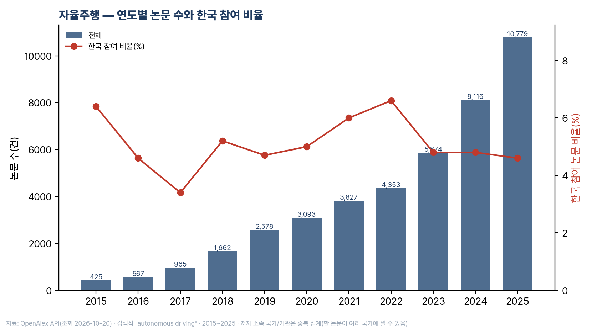
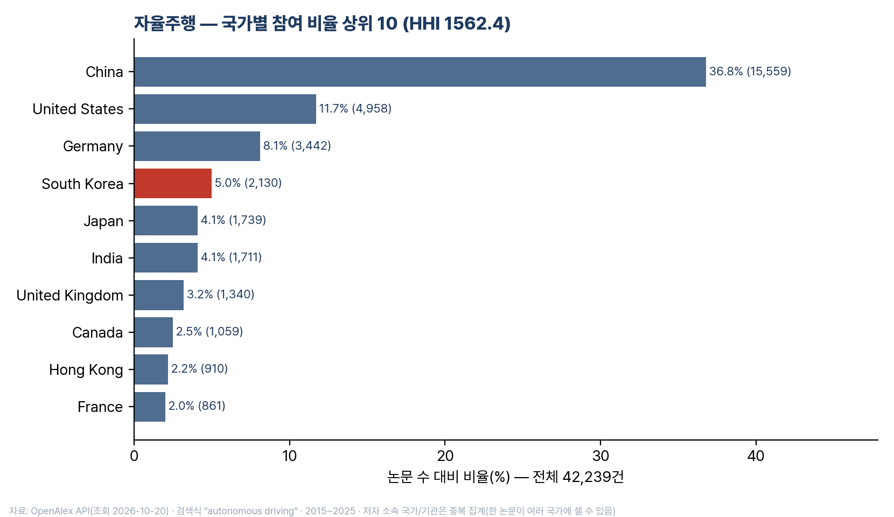
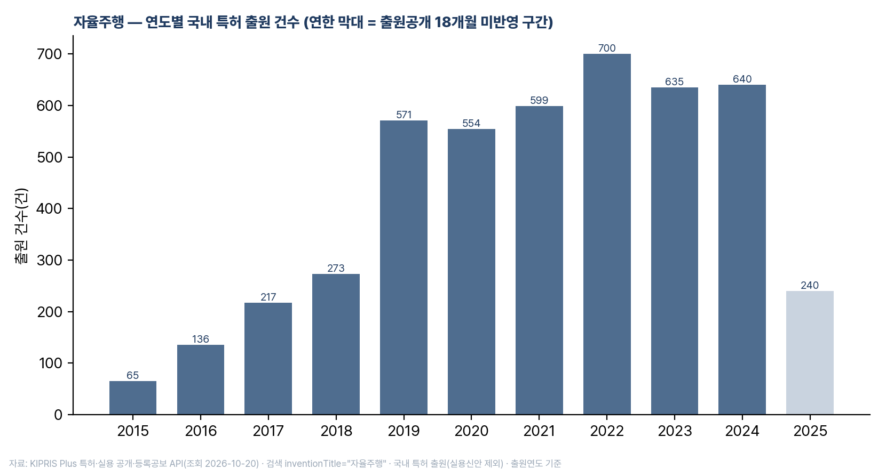
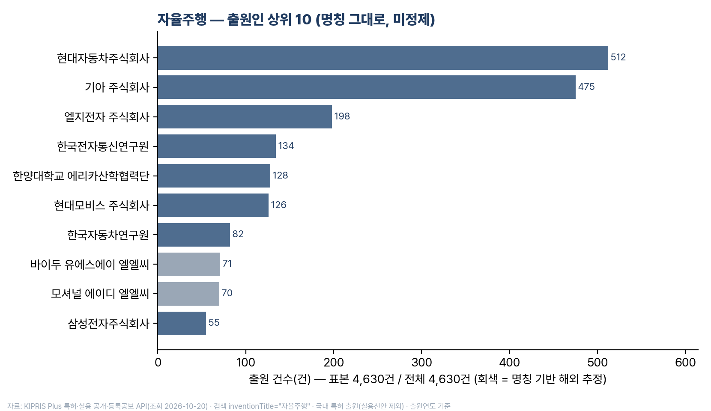

# sci-concentration

키워드 하나로 **논문**(OpenAlex) 연도별 추이 · 국가별 집중도(상위 10, 점유율, HHI) · 기관별 상위 10 · 한국 순위 추이와,
**특허**(KIPRIS Plus, 국내 출원) 연도별 출원 추이 · 출원인 상위 10 · 출원 상태 분포를 표(md·csv)와 그래프(PNG, 한글 글꼴)로 만들고,
수치마다 출처 URL과 조회일을 남기는 도구입니다. 유망산업·신흥기술 후보의 연구 동인과 경쟁 구도를 빠르게 보는 용도로 만들었습니다.

*CLI that turns a keyword into (1) publication trends, country/institution concentration (top 10, shares, HHI) and Korea's
rank over time from the **OpenAlex** API, and (2) Korean patent filing trends, top applicants and status from the
**KIPRIS Plus** API — tables (md/csv), PNG charts with Korean fonts, and a summary that cites every number with its API URL
and retrieval date. Each user needs their own (free) API keys; see "키 발급".*

- 데이터: [OpenAlex](https://openalex.org) 공개 API(논문) · [KIPRIS Plus](https://plus.kipris.or.kr) API(특허, `--patents`).
- 의존성: Python 3.9+ 표준 라이브러리. 그래프만 `matplotlib`(없으면 표·요약만 생성).
- 비용: 논문 키워드 1건당 호출 16회(`--quick` 5회), 약 10초. 특허는 연도 수 + 레코드 페이지 수(기본 최대 10) ≈ 21회, 약 17초.
- **키는 각자 발급**합니다(아래 「키 발급」). 키는 저장소에 넣지 않습니다.

## 키 발급 (각자, 무료)

| 소스 | 어디서 | 한도 | 키를 두는 곳(우선순위 순) |
|---|---|---|---|
| OpenAlex(논문) | https://openalex.org/signup → Settings → API key | 키 없이도 되지만 공인 IP당 하루 약 100회를 공유. 무료 키는 계정당 $1/일(약 1,000회) | `--api-key` → env `OPENALEX_API_KEY` → `~/.config/sci-concentration/openalex.key` |
| KIPRIS Plus(특허) | https://plus.kipris.or.kr 회원가입 → 「특허·실용 공개·등록공보」 API **활용 신청**(개발 계정 자동 승인) → 서비스키 | 무료 **월 1,000회**(매월 1일 초기화), 초당 50회 미만 | env `KIPRIS_API_KEY` → `~/.config/sci-concentration/kipris.key` → `~/.kipris/key` |

```bash
mkdir -p ~/.config/sci-concentration && chmod 700 ~/.config/sci-concentration
echo "<OpenAlex 키>" > ~/.config/sci-concentration/openalex.key
echo "<KIPRIS 서비스키>" > ~/.config/sci-concentration/kipris.key
chmod 600 ~/.config/sci-concentration/*.key
```

키는 개인 자격증명이라 공유하거나 커밋하지 않습니다(`.gitignore`에 `*.key`). 신청하지 않은 API를 부르면 KIPRIS가 `resultCode 101`을 돌려줍니다.

## 설치

```bash
git clone https://github.com/parkjui92/sci-concentration.git
cd sci-concentration
python3 -m pip install matplotlib        # 그래프용(선택)
python3 -I concentrate.py --selftest     # 오프라인 자체 검사
```

한글 글꼴은 Pretendard → Apple SD Gothic Neo → NanumGothic 순으로 찾습니다. 하나도 없으면 글자가 깨지고 exit 3으로 알립니다.

## 쓰는 법

```bash
# 영문 검색어 (두 낱말 이상이면 자동으로 구 검색 "…")
python3 -I concentrate.py "autonomous driving" --years 2015-2025

# "국문 라벨 / 영문 검색어" — 라벨은 폴더·그래프 제목, 검색어는 OpenAlex
python3 -I concentrate.py "휴머노이드 로봇 / humanoid robot"

# 여러 키워드 한 번에
python3 -I concentrate.py "자율주행 / autonomous driving" "AI 반도체 / AI semiconductor"

# 검색식 직접 지정(불리언) — 좁은 용어는 OR로 묶는다
python3 -I concentrate.py "AI 반도체" --query '"AI semiconductor" OR "AI chip" OR "AI accelerator" OR "neural processing unit"'

# 빠르게(호출 5회): 연도별 한국 순위 생략
python3 -I concentrate.py "humanoid robot" --quick

# 논문 + 특허 한 번에 — "/" 앞 국문 라벨이 KIPRIS 검색어(발명의 명칭)가 된다
python3 -I concentrate.py "자율주행 / autonomous driving" --patents
python3 -I concentrate.py "AI 반도체 / AI semiconductor" --patents --patent-term "인공지능 반도체" --patent-field abstract

# 특허만
python3 -I kipris_patents.py "자율주행" --years 2015-2025 --max-pages 10
```

| 옵션 | 뜻 |
|---|---|
| `--years 2015-2025` | 기간(기본값) |
| `--field title_and_abstract\|title\|default` | 검색 필드. 기본 제목+초록. `default`는 본문 전체라 건수가 수십 배 커진다 |
| `--loose` | 두 낱말 이상이어도 구 검색(따옴표)을 하지 않음 |
| `--quick` | 연도별 국가 순위(연도 수만큼 추가 호출) 생략 |
| `--out 폴더` | 출력 폴더(기본 `./out/<라벨>/`) |
| `--api-key` / env `OPENALEX_API_KEY` / `~/.config/sci-concentration/openalex.key` | OpenAlex 키(선택) |
| `--mailto` / env `OPENALEX_MAILTO` | polite pool용 이메일(선택) |
| `--no-chart` | 그래프 생략 |
| `--patents` | KIPRIS Plus 국내 특허도 함께(키 필요) |
| `--patent-term` | 특허 검색어(국문). 기본: 라벨에 한글이 있으면 라벨 |
| `--patent-field title\|abstract\|word\|claim\|ipc` | 특허 검색 필드. 기본 `title`(발명의 명칭). `word`(자유검색)는 매우 넓다(실측 "자율주행" title 4,849 vs word 54,741) |
| `--max-pages` | 출원인 집계용 레코드 페이지 상한(500건/페이지, 기본 10 = 5,000건) |

## 출력 `out/<라벨>/`

| 파일 | 내용 |
|---|---|
| `요약.md` | 핵심 수치(〔원문〕/〔계산〕 표시) · 표 3종 · 읽을 때 주의 · 호출 기록 |
| `표1_연도추이.md/.csv` | 연도 · 논문 수 · 한국 참여 논문 수 · 한국 비율 · 한국 순위 |
| `표2_국가집중도.md/.csv` | 상위 10 국가 · 논문 수 · 전체 대비 % · 국가 합계 대비 % · HHI |
| `표3_기관상위10.md/.csv` | 상위 10 기관 · 국가 · 논문 수 |
| `그림1_연도추이.png` `그림2_국가점유율.png` `그림3_기관상위10.png` | 200dpi, 그림 아래 자료 줄(검색식·조회일·집계 방식) |
| `호출기록.md` | 호출 URL 전부 + count + OpenAlex가 해석한 검색식(OQL) |
| `raw/*.json` | API 원 응답(재검증용) |
| `표4_특허_연도추이` `표5_특허_출원인상위10` `표6_특허_상태분포` (md·csv) | `--patents` 시. 출원연도별 totalCount · 출원인 명칭 그대로 상위 10(해외는 명칭 기반 〔추정〕) · 등록/공개/거절 등 |
| `그림4_특허_연도추이.png` `그림5_특허_출원인상위10.png` | `--patents` 시. 최근 연도(출원공개 18개월 미반영)는 연한 막대 |
| `요약_특허.md` `호출기록_특허.md` `raw/kipris_page*.json` | `--patents` 시(요약.md 뒤에도 같은 절이 붙는다) |

`examples/`에 세 키워드의 실제 산출물이 있습니다(2026-10-20 조회).






## 수치의 뜻

- **전체 논문 수** = `meta.count` 〔원문〕. **국가·기관 건수** = `group_by` 응답 값 〔원문〕 — 저자 소속 기준 **중복 집계**(한 논문이 여러 국가·기관에 셈).
- **전체 대비 %** = 국가 건수 ÷ 전체 논문 수(합이 100%를 넘음). **국가 합계 대비 %** = 국가 건수 ÷ 모든 국가 건수 합.
- **HHI** = 국가 합계 대비 %의 제곱합(10,000 만점). "1,500 미만 분산·2,500 초과 집중"은 미국 DOJ/FTC 합병 지침 구간을 **차용**한 것으로 학술 기준이 아닙니다.
- **한국 비율** = 한국 소속 저자가 1명 이상인 논문 ÷ 전체. **한국 순위** = 그 해 국가 건수 내림차순 순위.
- 검색 필드 기본값은 제목+초록(`title_and_abstract.search`). 실측: "AI semiconductor" 제목·초록 39건 vs 본문 전체 64,550건.

## 검증 (2026-10-20)

| 항목 | 도구 값(group_by) | 독립 대조 호출(`meta.count`) | 일치 |
|---|---|---|---|
| "autonomous driving" 제목·초록 2015~2025 전체 | 42,239 | 42,239 | ✅ |
| 그중 한국 참여 | 2,130 | 2,130 | ✅ |
| 2025년 | 10,779 | 10,779 | ✅ |

연도 그룹 합계 = 전체 건수(내부 정합). 같은 조건의 웹 화면: https://openalex.org/works?filter=title_and_abstract.search:%22autonomous%20driving%22,publication_year:2015-2025

## API 키와 하루 예산 (중요)

키 없는 요청은 **같은 공인 IP의 모든 이용자가 하루 예산(OpenAlex 안내 약 $0.10, 호출당 $0.001 ≈ 100회)을 나눠 씁니다.**
실측: 키워드 4건(약 60회)을 돌리자 그날 예산이 소진돼 `HTTP 429 Insufficient budget`이 났고, 자정 UTC(09:00 KST)에 초기화됩니다.
무료 키(계정당 $1/일)는 https://openalex.org/settings/api 에서 받아 다음 중 한 곳에 둡니다.

```bash
export OPENALEX_API_KEY=...                       # 환경변수
mkdir -p ~/.config/sci-concentration && chmod 700 ~/.config/sci-concentration
echo "..." > ~/.config/sci-concentration/openalex.key && chmod 600 ~/.config/sci-concentration/openalex.key
```

한도 상세: https://help.openalex.org/how-to-use-the-api/rate-limits-and-authentication

## 특허 수치의 뜻과 함정 (KIPRIS Plus)

- **출원 건수** = 연도별 `applicationDate=YYYY0101~YYYY1231` 검색의 `totalCount` 〔원문〕. 국내 특허 출원(KR 공보) 단위이며 실용신안 제외, 패밀리 단위가 아닙니다.
- **출원인 상위 10** = 출원일 내림차순으로 받은 레코드(기본 최대 5,000건)에서 `applicantName`을 셈. 공동출원(`|`)은 출원인마다 1건. 명칭은 **미정제**(삼성전자 vs 삼성전자주식회사, 계열사)라 그대로 보입니다. "해외"는 명칭 접미(인코포레이티드·리미티드·게엠베하 등) 기반 **추정**이며 국적 자료가 아닙니다.
- **출원공개 18개월 블라인드**(특허법 제64조): 최근 약 2개 연도는 아직 공개되지 않은 출원이 빠져 구조적으로 적게 나옵니다. 그래프에서 연한 막대이며, 감소로 읽지 않습니다.
- 논문의 "국가별 집중도"에 해당하는 특허 국가별 집계는 없습니다(국내 공보에는 출원인 국적 필드가 없음). 국제 비교는 EPO OPS·Lens 등 패밀리 단위 소스가 필요합니다.
- 건수는 혁신의 질이 아닙니다(방어출원·특허덤불). 등록 ≠ 유효(연차료 미납 소멸).

다른 특허 경로(2026-10-20 키 없이 확인): PatentsView 구 API 폐지(USPTO ODP는 401), EPO OPS 403, Lens 401 — 모두 키가 필요합니다. 이 도구는 KIPRIS Plus만 붙였습니다.

## 한계

- OpenAlex는 영문 서지 중심이라 국문 학술지 수록이 부분적입니다. **"0건"은 "연구가 없다"가 아니라** 검색식·수록 범위 밖일 수 있습니다.
- 최근 연도(당해·전년)는 수록 시차로 과소. 기관명은 OpenAlex 정규화 영문명.
- python.org 파이썬은 OS 인증서를 안 봐 SSL 오류가 날 수 있어 certifi → curl 순으로 폴백합니다.
- 발표·보고서에 쓸 때는 검색식·조회일·집계 방식(중복 집계)을 함께 적으세요.

## 실행 예 (2026-10-20 실측, `examples/`)

| 라벨 | 논문 검색식(OpenAlex) | 논문 전체 | 한국 | 한국 순위 | HHI | 특허 검색(KIPRIS) | 출원 | 출원인 1·2위 |
|---|---|---|---|---|---|---|---|---|
| 자율주행 | "autonomous driving" | 42,239 | 2,130 (5.0%) | 4위 | 1,562 | title "자율주행" | 4,630 | 현대자동차 512 · 기아 475 |
| AI 반도체 | "AI semiconductor" OR "AI chip" OR "AI accelerator" OR "neural processing unit" | 2,156 | 201 (9.3%) | 3위 | 1,178 | abstract "AI 반도체" | 62 | (요약_특허.md) |
| 휴머노이드 로봇 | "humanoid robot" | 12,433 | 377 (3.0%) | 9위 | 635 | abstract "휴머노이드 로봇" | 82 | (요약_특허.md) |

논문 16회·약 10초, 특허 21회·약 17초(자율주행). 특허 검색어가 좁으면(AI 반도체 title 38건) `--patent-field abstract`로 넓힌다.

## 라이선스

MIT (소프트웨어). 데이터는 OpenAlex(CC0)에서 조회한 것이며 각 산출물에 조회 URL·조회일이 남습니다.
